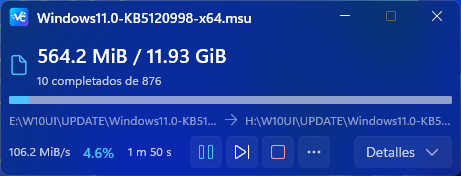
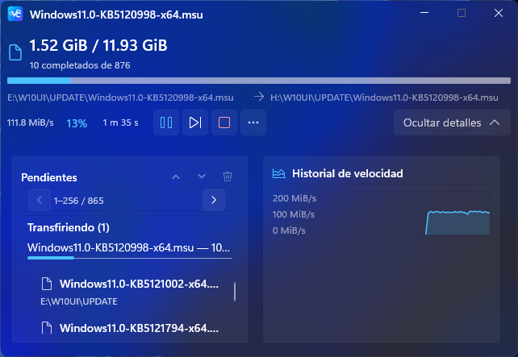
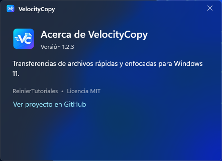

<div align="center">


# VelocityCopy

### A faster, smarter, and cleaner way to copy and move files on Windows 11.

**Simple when you need it. Powerful when you want more.**

</div>

VelocityCopy is a native C++ and WinUI 3 file transfer utility for Windows 11.
Keep progress and transfer controls in a compact window, then expand the details
to follow the pending queue and speed history.

## Screenshots

Screenshots show the Spanish interface captured during 1.2.3 development,
before the 1.3.0 version update.
Transfer speeds and remaining times reflect the captured session, not a benchmark.

### Compact transfer view

Progress, transferred data, speed and remaining time alongside the transfer controls.



### Queue and speed history

Expand Details to inspect pending files and follow the speed history in the same window.



### About VelocityCopy

Product version, license and project link in a window that follows the application theme.



## Status

VelocityCopy 1.3.0 targets Windows 11 x64 and ARM64 with native, self-contained,
unsigned installers. See [Releases](https://github.com/ReinierTutoriales/VelocityCopy/releases)
for published downloads and [CHANGELOG](CHANGELOG.md) for the changes. Every change
is validated by Windows CI and Windows Package before integration.

Current automated baseline (`main`):

- x64 Release tests
- ARM64 core compile
- ASan RelWithDebInfo compile
- self-contained unpackaged WinUI for x64 and ARM64
- `VelocityCopy-Setup-x64.exe` and `VelocityCopy-Setup-ARM64.exe`

Download installers from Releases. Use the setup that matches the PC: x64 setup refuses ARM64 Windows, and the ARM64 setup refuses x64 Windows.

## What it does

- Drag and drop files into a compact WinUI 3 window
- Overall progress view with an expandable queue
- Pause, resume, skip, stop and cancel
- Save and load copy queues
- Native per-session shutdown recovery with Resume/Discard decisions
- Explorer right-button transfer handler with explicit Copy here / Move here commands
- Silent startup via an installer-owned HKCU Run entry (`--startup`)
- One process-owned tray icon with EcoQoS while eligible and idle

While VelocityCopy is resident, Ctrl+V in normal Explorer filesystem folder views
routes copied or cut files into its transfer queue. Ctrl+C/X remain native Windows
commands. This does not replace every Paste command, virtual folder or other application.

## Repository layout

```text
src/core     copy engine, planner, queue, IPC
src/ui       unpackaged WinUI 3 shell
src/shell    Explorer in-process COM server
tools        NSIS script, install helper, benchmarks
tests        core and architecture contracts
docs         product and release-gate rules
docs/screenshots  application screenshots used in this README
.github      Windows CI and Windows Package
```

`main` is the only intended long-lived branch. Do not keep temporary or merged fix branches.

Before changing CI or Package, read `docs/RELEASE_GATES.md`. Those workflows are protected by architecture contracts.

## Build locally

```bat
cmake -S . -B build/x64 -A x64
cmake --build build/x64 --config Release --parallel
ctest --test-dir build/x64 -C Release --output-on-failure
```

Installers are produced by GitHub Actions, not by the local CMake tree.

## License

VelocityCopy is available under the MIT License.
